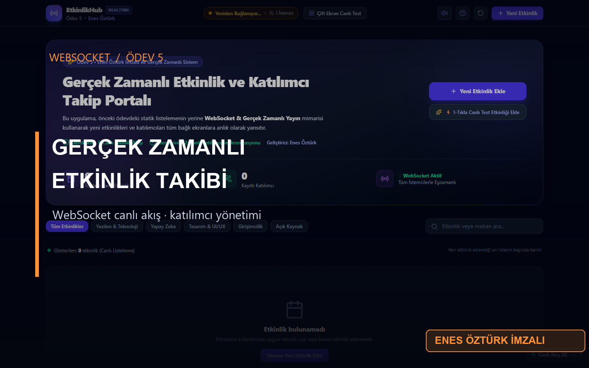
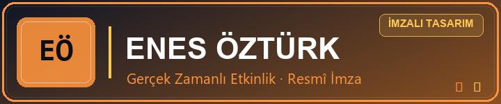
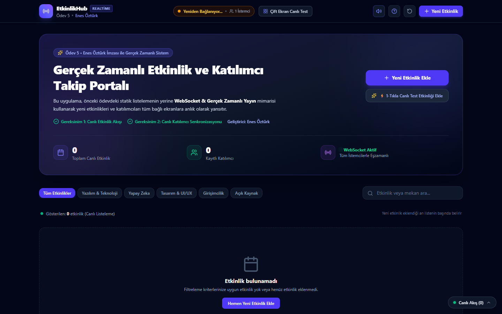
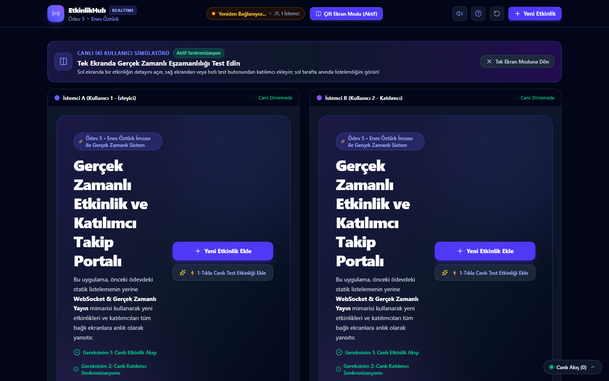
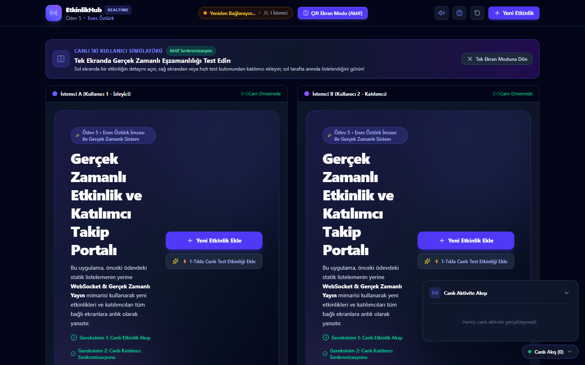

<div align="center">



# Gerçek Zamanlı Etkinlik Takibi

**Ödev 5 — WebSocket üzerinden canlı akış, katılımcı yönetimi ve çift ekran test simülatörü içeren etkinlik sistemi.**

[](https://github.com/EnesBinMalik/gercek-zamanli-etkinlik)
[](https://github.com/EnesBinMalik/gercek-zamanli-etkinlik)
[](https://github.com/EnesBinMalik/gercek-zamanli-etkinlik)
[](https://github.com/EnesBinMalik/gercek-zamanli-etkinlik)
[](https://github.com/EnesBinMalik/gercek-zamanli-etkinlik)
[](https://github.com/EnesBinMalik)



</div>

---

## Hakkında

Bu sistem, etkinliklerde yapılan değişikliklerin tüm bağlı istemcilere anında iletilmesini sağlar. Express + `ws` ile kurulan sunucu, yeni etkinlik ve katılımcı olaylarını yayınlar; arayüzdeki canlı akış paneli ve çift ekran simülatörü gerçek zamanlı davranışı görsel olarak doğrular.

> Bu proje **Enes Öztürk** tarafından tasarlanmış, geliştirilmiş ve imzalanmıştır.

---

## Öne çıkan özellikler

| Özellik | Açıklama |
| --- | --- |
| **WebSocket sunucusu** | Anlık olay yayını ve otomatik yeniden bağlanma. |
| **Canlı akış paneli** | Tüm istemci olaylarını zaman damgasıyla listeler. |
| **Çift ekran test** | İki ayrı istemciyi yan yana simüle eder. |
| **1-tıkla test** | Hazır canlı etkinlik ile senaryoyu başlatır. |
| **Katılımcı yönetimi** | Etkinliğe katılım ve katılımcı listesi. |
| **Kategori filtreleri** | Yazılım, yapay zekâ, tasarım, girişimcilik. |

---

## Canlı sistem

| Ölçü | Değer |
| --- | --- |
| Protokol | WebSocket |
| İstemci | Çoklu |
| Mod | Çift ekran |
| Test | 1 tık |

---

## Galeri







---

## Kurulum

**Gereksinim:** Node.js 20+

```bash
git clone https://github.com/EnesBinMalik/gercek-zamanli-etkinlik.git
cd gercek-zamanli-etkinlik
npm install
npm run start
```

> Sunucu ve istemci aynı süreçte başlatılır; ek kurulum gerekmez.

Diğer komutlar:

```bash
npm run build     # Üretim derlemesi
npm run preview   # Derlemeyi önizle
npm run lint      # TypeScript tip kontrolü
```

---

## Teknik mimari

```text
server.ts                    WebSocket + REST sunucusu
src/context/RealtimeContext.tsx  Bağlantı ve olay durumu
src/components/SplitScreenSimulator.tsx  Çift ekran test
src/components/LiveActivityDrawer.tsx    Canlı akış
src/components/CreateEventModal.tsx      Etkinlik oluşturma
```

---

## İmza

<div align="center">

[](https://github.com/EnesBinMalik)
[](https://github.com/EnesBinMalik)

**Bu kod, tasarım ve deneyim Enes Öztürk'ün kişisel imzasını taşır.**

© 2026 Enes Öztürk — Tüm hakları saklıdır.

</div>
